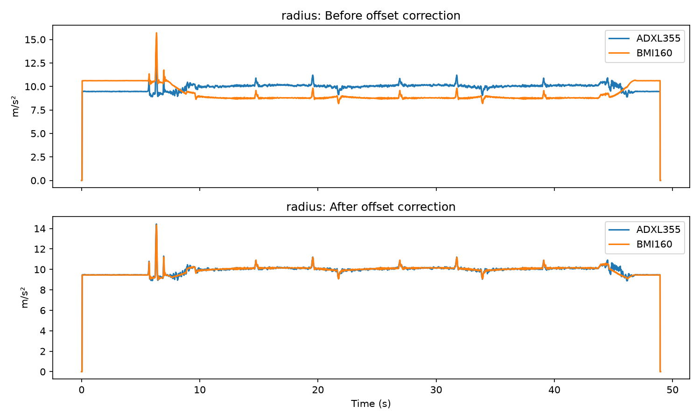

# Robot Arm IMU Analysis

A Python analysis of sensor data from four IMUs (motion sensors) strapped to a UR5 robot arm. The question that started it: **do the two accelerometers inside each sensor agree with each other?**

At first they looked like they didn't. Tracing why turned out to be the interesting part.

## The problem

Each IMU contains two accelerometers (ADXL355 and BMI160) measuring the same motion. Comparing the total strength of their readings, two of the four sensors showed correlations near zero or even negative (humerus -0.08, radius -0.13), which would suggest a faulty sensor.

## What I found

The sensors agree. The apparent disagreement came from small per-axis calibration offsets, up to about 1.2 m/s² on a single axis, which distorted my first measure.

| IMU | Correlation before offset removal | After |
|---|---|---|
| humerus | 0.848 | 0.990 |
| radius | 0.072 | 0.981 |
| carpus | 0.970 | 0.969 |
| digitus | 0.977 | 0.978 |

(All values use smoothed readings, averaged over 0.1 s per axis.)

The top panel shows the radius sensor's two accelerometers sitting apart. In the bottom panel, after subtracting each axis's average offset, they overlap.

## Limitations

- I only analysed one recording (the `triangle-150` scenario), so I can't say whether the offsets stay the same across recordings.
- The offset correction assumes each offset is constant. It is an approximation, not a proper calibration.
- Two settings are my own choices: a 10-reading smoothing window and a threshold of 5 m/s² for spotting spikes. Other values would give slightly different numbers.
- I haven't confirmed the gyroscope units, so I don't state them.
- The spikes appear one after another along the arm (digitus at 3.6 s, then carpus, radius and humerus), but I haven't explained why. The robot's own data would help, and I haven't used it yet.
- The raw data isn't included in this repo.

## What I learned

- My first measure (total acceleration strength) hid the real picture. Looking at each axis separately was what revealed the problem.
- A hypothesis that turns out wrong is still useful. Testing the "spike" idea ruled it out and pushed me towards the real cause.
- The order of operations matters: smoothing each axis before combining them gives different numbers from combining first.

## Data

OpenAXES robot-arm IMU dataset: https://github.com/OpenAXES-IMU/OpenAXES. Please check the dataset's own page for its licence and how to cite it.